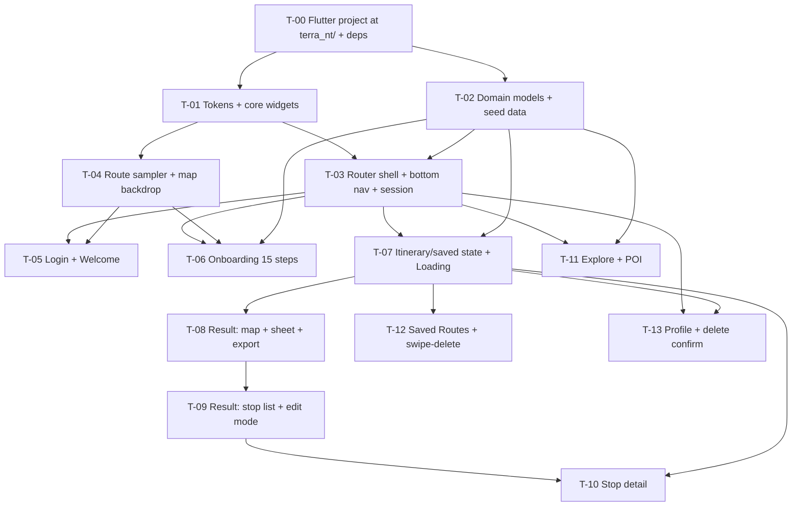

# Ticket Breakdown — Terra NT Route Planner (Flutter rewrite)

Sliced from `design/PRD.md` (epic) + `design/CLAUDE.md` → Architecture / Stack / Definition of done / Open decisions.
Suggested order of work in `design/README.md` was used as the starting sequence — see **Deviation from README order** below.

## Epic summary

Rebuild the Terra NT Route Planner prototype natively in Flutter: login → optional 15-step onboarding →
AI-generated 7-stop NT itinerary on a map → edit/reorder/skip stops → export to Google Maps, plus an explore
map, saved routes with swipe-to-delete, and a profile screen. 9 screens, no backend — auth is mocked and all
stop/POI data is seeded verbatim from `design-reference/Terra NT.dc.html`.

## State of the code

**Greenfield app, initialised repo.** Git is set up (`main`, first commit `bdeb783`) and the docs bundle is in
place, but there is no `pubspec.yaml` and no `lib/` — **T-00 creates them.** From T-01 on, every ticket creates
new files and none of them edit existing code. That removes file-overlap conflicts as a parallelism constraint —
the only real constraint is *seam readiness* (a ticket can't consume a notifier or widget that doesn't exist yet).

## Repo layout these tickets assume

The Flutter project is **not** the repo root. It lives in `terra_nt/` and contains only the app:

```
Terra NT/            ← repo root: git, docs, design, agent config
├── CLAUDE.md  README.md  .claude/  design/  docs/
└── terra_nt/        ← Flutter project — lib/, test/, pubspec.yaml, android/, ios/
```

Nothing from `design/`, `docs/`, `.claude/` or `README.md` moves under `terra_nt/`. Every path in a ticket's
*Files touched* is relative to `terra_nt/` unless it starts with `design/` or `docs/`. Run all Flutter and Dart
commands from `terra_nt/`; doc references from there are `../design/…`.

## Architecture seams these slices respect

Per `design/CLAUDE.md` → Architecture:

| Seam | Owner ticket | Consumed by |
|---|---|---|
| `terra_nt/` project + `pubspec.yaml` deps + analyzer config | T-00 | every ticket |
| `ui/core/theme/` — tokens, typography, motion | T-01 | every UI ticket |
| `ui/core/widgets/` — button, tag chip, pill badge, placeholder tile, switch | T-01 | every UI ticket |
| `domain/` — `Stop`, `Poi`, `SavedRoute`, `OnboardingAnswers`, `Itinerary` (pure Dart) | T-02 | T-06…T-13 |
| `data/` — seeded stops/POIs/routes, saved-routes store | T-02 | T-07, T-12 |
| `go_router` shell + `SessionNotifier` (email, onboardingDone) | T-03 | T-05…T-13 |
| Arc-length route sampler + animated map backdrop | T-04 | T-05, T-06 |
| `ItineraryNotifier` (order, skipped, editMode, detailed) | T-07 | T-08, T-09, T-10 |
| `SavedRoutesNotifier` (upsert by stable id, delete) | T-07 | T-12, T-13 |

Views stay lean (layout/animation/routing only); notifiers expose immutable snapshots; all pure logic
(arc-length sampling, Maps URL building, snap thresholds, reorder/skip transforms) lives in plain Dart with no
Flutter imports, so it is unit-testable without `WidgetTester`.

---

## Tickets

### T-00 — Create the Flutter project and settle the repo layout

Everything else is blocked on this. It is deliberately small and has no design work in it — it exists so T-01
can open a `pubspec.yaml` that already exists and start on tokens rather than on `flutter create`.

**Scope / acceptance criteria**

*Project creation*
- `flutter create` run from the repo root, producing the project at **`terra_nt/`** — project name `terra_nt`
  (valid Dart package name; the folder name and the `name:` in `pubspec.yaml` match).
- Platforms: **Android and iOS only** (`--platforms=android,ios`). No web, no desktop — the design is phone-only
  (`CLAUDE.md` → Open decisions: tablet/landscape out of scope, don't invent a responsive spec).
- Org/bundle id chosen and recorded in the plan (e.g. `au.edu.cdu.terrant` or similar) — `flutter create` bakes
  it into the Android and iOS project files, and changing it later means regenerating both.
- The empty source layout from `CLAUDE.md` → Architecture exists with a `.gitkeep` in each: `lib/data/`,
  `lib/domain/`, `lib/ui/core/`, `lib/ui/features/`. The counterpart `test/` mirror too.
- The counter-app boilerplate `flutter create` generates is deleted, not left to rot: `lib/main.dart` reduced to
  a minimal dark-canvas `MaterialApp` placeholder, and the generated `test/widget_test.dart` removed (it tests
  the counter and will fail the moment `main.dart` changes).

*The layout rule — the point of this ticket*
- **`terra_nt/` contains only the Flutter app.** `design/`, `docs/`, `.claude/`, `README.md` and `.gitignore`
  stay at the repo root and do **not** move, copy, or symlink under `terra_nt/`.
- `design/CLAUDE.md` moves to the repo root as `CLAUDE.md` (`git mv`, so history follows). It is not copied into
  `terra_nt/` — Claude Code reads parent directories, so a root `CLAUDE.md` applies while the working directory
  is `terra_nt/`. Its **File placement** section already describes this layout; confirm it still reads true after
  the move and fix any path that no longer resolves.
- Doc cross-references still resolve after the move. Grep the four docs (`CLAUDE.md`, `design/PRD.md`,
  `design/README.md`, `docs/tickets/terra-nt-route-planner.md`) for relative paths and fix the ones that broke —
  `README.md → Suggested order of work` is referenced from `CLAUDE.md` → Definition of done, and
  `design/PRD.md` is referenced from nearly everything.

*Tooling*
- `pubspec.yaml` carries the dependencies pinned in `CLAUDE.md` → Stack / conventions: `flutter_riverpod ^3.4.2`,
  `riverpod_annotation ^4.0.6`, `go_router ^18.0.0`, `flutter_map ^8.3.1`, `latlong2`, `flutter_lucide ^1.34.0`,
  `flutter_slidable ^4.0.3`, `url_launcher`; dev deps `riverpod_generator ^4.0.8`, `build_runner`,
  `custom_lint`, `riverpod_lint`. **Deps only — T-01 still owns `ui/core/theme/`.** Adding them here means T-01
  never has to touch `pubspec.yaml` and can run in parallel with T-02 without a merge conflict on it.
- `flutter pub get` resolves cleanly, and `dart run build_runner build` runs green on the empty project (proving
  the code-gen toolchain works before T-03 depends on it). If a version above no longer resolves against Flutter
  3.47.1 / Dart 3.13.1, use `dart-resolve-package-conflicts` and **record the changed pin in `CLAUDE.md`** rather
  than silently drifting from the documented stack.
- `analysis_options.yaml` in `terra_nt/` enables `flutter_lints` plus `custom_lint` (for `riverpod_lint`), with
  the analyzer configured so `dart analyze` is clean on the fresh project — that is gate 1 of Definition of done
  and it has to be enforceable from day one.
- The font decision is made and implemented: either `google_fonts` is added to `pubspec.yaml`, or Inter
  (400/500/600/700) and JetBrains Mono (400/500) are bundled as asset fonts and declared in `pubspec.yaml`.
  **This must land in T-00**, before any golden exists — goldens are font-rendering-sensitive, so switching the
  font source later invalidates every checked-in golden file. See `design/design-system/README.md` →
  substitution 1.

*Git hygiene*
- The root `.gitignore` is corrected for the subfolder layout. It is currently a stock Flutter ignore file with
  **root-anchored patterns that no longer match** — `/build/`, `/coverage/`, `/android/app/debug`,
  `/android/app/profile`, `/android/app/release` all assume Flutter is at the repo root and will silently fail to
  ignore `terra_nt/build/` etc. Either re-anchor them (`terra_nt/build/`) or let `flutter create`'s own
  `terra_nt/.gitignore` own the Flutter-specific rules and strip the stale ones from the root file. Verify with
  `git status --porcelain` after a debug build: no build output, no `.dart_tool/`, no `.flutter-plugins-*`.
- `flutter build apk --debug` (or `flutter run` on a device/emulator) succeeds once, proving the toolchain and
  the Android project are wired — then confirm the build output is ignored.

**Definition of done**
- `cd terra_nt && flutter pub get && dart analyze && flutter test` all succeed on the placeholder app.
- `git status` is clean after a build.
- `ls` at the repo root shows `CLAUDE.md`, `README.md`, `.claude/`, `design/`, `docs/`, `terra_nt/` — and
  `ls terra_nt` shows no `design`, `docs`, `.claude`, or `README.md`.

**Per-ticket context:** `CLAUDE.md` → Stack / conventions, Architecture, File placement ·
`design/README.md` → Repo layout · `design/design-system/README.md` → substitution 1 (fonts).
**Files touched (est.):** `terra_nt/**` (generated), `terra_nt/pubspec.yaml`, `terra_nt/analysis_options.yaml`,
`terra_nt/lib/main.dart`, root `.gitignore`, `git mv design/CLAUDE.md CLAUDE.md`, doc path fixes. Little
hand-written code — mostly generated scaffold plus config. ~150 hand-written lines.
**Depends on:** none. **Blocks:** every other ticket.
**Blocking decision:** the org/bundle id, and `google_fonts` vs bundled font files. Both are cheap now and
expensive after T-01 — resolve them in the planning interview.

---

### T-01 — Design tokens, core widgets, test harness

**Scope / acceptance criteria**
- Project, deps and analyzer config already exist (T-00). This ticket adds no dependency and does not touch `pubspec.yaml` — if it needs to, that is a sign T-00 was under-scoped; go back and amend T-00 rather than editing the pubspec here, so T-02 can run in parallel without a conflict on it.
- `ui/core/theme/` defines every token from `PRD.md` → Design tokens exactly once, by name: canvas, 4-step surface ladder, 4-step ink ladder, primary + hover + press, success, 3 hairline levels, the 6 tag colors, the 3 type roles with their negative letter-spacing ramp, the 4·8·12·16·24·32·48·96 spacing scale, the 4/8/12/16/pill radius set, `shadow-overlay` (`0 8px 32px rgba(0,0,0,0.6)`), the edge highlight (`inset 0 1px 0 rgba(255,255,255,0.06)`), and the 80/120/160/240 ms motion values on `cubic-bezier(0,0,0.2,1)`. Dark only — no `ThemeData` light variant. Cross-check every value against `design/design-system/tokens/*.css`, which is authoritative.
- Shared widgets in `ui/core/widgets/`: primary/secondary button (md + lg, full-width variant, optional leading/trailing icon), tag chip (colored dot + label), pill badge, placeholder icon-in-box tile, pill switch, list card row.
- `dart analyze` stays clean (T-00 made that enforceable; this ticket keeps it true).
- Golden-test harness is set up and proven on one core widget: fonts loaded deterministically from the source T-00 chose, `flutter test --update-goldens` produces a checked-in file, a re-run compares green. Document the pinned generation environment in the test README (goldens are platform/font-sensitive).
- No hardcoded hex or magic number outside `ui/core/theme/`; a grep-based check or lint confirms it.

**Per-ticket context:** `PRD.md` → Design tokens, Assets · `design/design-system/tokens/*.css` (authoritative values) · `CLAUDE.md` → Stack / conventions, Design tokens, Fidelity, Definition of done gates 1 + 3.
**Files touched (est.):** `lib/main.dart`, `lib/ui/core/theme/*` (4–5 files), `lib/ui/core/widgets/*` (6–7 files), `test/` harness + widget goldens. ~700–1000 lines (~30% tests).
**Depends on:** T-00.
**Blocking decision:** none. The six tag hexes now exist in `design/design-system/tokens/colors.css` — provisional (derived from the accent hue family, not sampled from the real product), but concrete enough to build on. Define them as named tokens so a later correction is a one-line change.

---

### T-02 — Domain models + seeded data (pure Dart)

**Scope / acceptance criteria**
- Immutable models with value equality: `Stop` (`name, subtitle, lat, lng, hours, fee?, driveNextLabel?, durationLabel, aiNote, tags, detailedPlan`), `Poi`, `SavedRoute`, `OnboardingAnswers`, `Itinerary`.
- `OnboardingAnswers` carries all 15 fields with the prototype's defaults (`days = 7`, `heat = 3`, `focus = []`, everything else null/false) and a `copyWith`.
- All 7 stops seeded **verbatim** from `design-reference/Terra NT.dc.html` — names, subtitles, hours, fees, drive labels, durations, AI notes, tags, and every hourly-plan row. A test asserts 7 stops, that only Kakadu/Nitmiluk-class entries carry a fee, and that the last stop has a null `driveNextLabel`.
- All 8 POIs seeded with the lat/lngs from `terra-nt-explore-map.html` and the copy from the prototype.
- The 2 seeded saved routes, the 5 loading messages, and the 5 heat-tolerance labels seeded verbatim.
- Tag → color-token mapping as a pure function over a domain enum (Nature/Culture/Adventure/Wildlife/Relaxation), with a unit-tested fallback for an unknown tag. The enum→`Color` resolution stays in `ui/core/theme` (T-01); the mapping itself has no Flutter import.
- Zero Flutter imports anywhere in this ticket. `dart analyze` clean.

**Per-ticket context:** `PRD.md` → Data model (stops), State needed · `CLAUDE.md` → Source of truth ("carry the 7 seeded stops over verbatim, don't paraphrase copy").
**Files touched (est.):** `lib/domain/*` (5–6 files), `lib/data/seed/*` (3 files), `test/domain/*`. ~600–800 lines (~25% tests).
**Depends on:** T-00. **Runs in parallel with T-01** — pure Dart, no theme dependency, and no shared files with it.

---

### T-03 — App shell: declarative routing + bottom nav + session state

**Scope / acceptance criteria**
- `MaterialApp.router` + `go_router` with a `StatefulShellRoute` over the 4 tabs, so each tab keeps its own stack (Stop detail stays on the Plan AI stack across tab switches — covered by a navigation test).
- `SessionNotifier` (Riverpod `Notifier`): `email`, `onboardingDone`; actions `signIn(email)`, `completeOnboarding()`, `skipOnboarding()`, `logOut()`, `deleteAccount()`.
- Bottom nav meets every criterion in `PRD.md` → Bottom nav: 64px, surface-1, hairline top border, 4 equal tabs, 20px icon over 11px caption with 4px gap, Explore/`Compass` · Plan AI/`Sparkles` · Saved Routes/`Bookmark` · Profile/`User`, active = full ink, others = tertiary ink.
- The bar is present on Explore, Result, Saved Routes, Profile and absent on Login, Welcome, Onboarding, Loading, Stop detail — asserted per route in a test.
- The Plan AI tab resolves to Result when `onboardingDone` is true and Login when it is false — both cases tested.
- Golden test of the bar in each of the 4 active states; no layout exception at the narrowest supported width with "Saved Routes".
- Placeholder scaffolds for all 9 routes so navigation is testable before the screens land.

**Per-ticket context:** `PRD.md` → Bottom nav + its Acceptance criteria · `CLAUDE.md` → Stack (go_router, `StatefulShellRoute`), skill `flutter-setup-declarative-routing`.
**Files touched (est.):** `lib/ui/core/router/*`, `lib/ui/features/session/*`, `lib/main.dart`, `test/router/*`. ~500–700 lines (~35% tests).
**Depends on:** T-01 (theme + icons), T-02 (light — session holds no domain data yet).

---

### T-04 — Arc-length route sampler + animated map backdrop

**The one hard algorithm.** Isolated deliberately so it is proven before two screens consume it.

**Scope / acceptance criteria**
- Pure Dart `RoutePath`: builds a cumulative-distance table over a polyline and exposes `pointAtFraction(double t)`. **No lat/lng lerp between arbitrary points** — sampling walks the table.
- Unit tests: `t = 0` → first point, `t = 1` → last point, `t = 0.5` → a point on the geometrically correct segment (not the midpoint of the endpoints), clamping outside 0..1, and a degenerate 1-point path.
- A test proves the car visibly passes through every intermediate point: sampling at a dense series of `t` values yields a monotonically non-decreasing arc length that crosses every vertex.
- `flutter_map` backdrop widget with the dark CARTO tile layer (`dark_all`), OSM/CARTO attribution, and all gestures disabled (matching the prototype's `dragging/touchZoom/scrollWheelZoom/doubleClickZoom/boxZoom/keyboard/tap` = off).
- Two drive modes: a continuous loop (Login ambient) and an externally-driven fraction (Onboarding, `step / 14`), both off one `AnimationController` + one `0..1` progress value.
- The controller is disposed on unmount — a widget test asserts no ticker leak.

**Per-ticket context:** `PRD.md` → Interactions ("Car-follows-route animation") · `CLAUDE.md` → The one hard algorithm ("write this as a pure function first and unit-test it before wiring any widget") · reference `pointAtFraction` in `design-reference/terra-nt-bg-map.html`.
**Files touched (est.):** `lib/domain/route_path.dart`, `lib/ui/core/map/*` (2–3 files), `test/domain/route_path_test.dart`, `test/ui/map_backdrop_test.dart`. ~450–650 lines (~40% tests).
**Depends on:** T-01 (theme). Independent of T-02/T-03 — **can run in parallel with T-03**.

---

### T-05 — Login + Welcome screens

**Scope / acceptance criteria**
- Every bullet under `PRD.md` → 1. Login → Acceptance criteria and → 2. Welcome → Acceptance criteria.
- Login: full-bleed T-04 backdrop in loop mode + gradient overlay, "Terra NT" 44px display, "Discover the Northern Territory.", email + password inputs, "Start Exploring" primary, "or" divider, "Continue with Google" secondary — all copy character-for-character.
- Both buttons call `signIn(email)` and go to Welcome; the entered email reaches Profile, empty falls back to `explorer@example.com` (tested through the notifier, not the widget tree).
- Welcome: dimmer overlay, "Welcome to Terra NT" card, "Create My Route" → Onboarding, "Skip for Now" → `skipOnboarding()` + Explore, with a test proving the Plan AI tab then opens Result rather than Login.
- Golden tests against `screenshots/01-login.png` and `02-welcome.png`; `dart analyze` clean; no layout exceptions at phone widths.

**Per-ticket context:** `PRD.md` → screens 1 + 2 with their AC/Non-goals · `CLAUDE.md` → Fidelity, Definition of done.
**Files touched (est.):** `lib/ui/features/auth/views/*` (2 screens + parts), `test/ui/auth/*`, goldens. ~500–700 lines (~30% tests).
**Depends on:** T-03 (routing + session), T-04 (backdrop).
**Blocking decisions:** email/password validation (yes/no), and whether "Continue with Google" is real Sign-In or a mock. Both are TBD in `PRD.md`.

---

### T-06 — Onboarding, 15 steps

**Scope / acceptance criteria**
- Every bullet under `PRD.md` → 3. Onboarding → Acceptance criteria: exact 15-step order (indices 0–14), "n/15" counter, `round(((step+1)/15)*100)`% progress pill, backdrop fraction `step / 14`.
- Step widgets: single-select rows (8 steps), multi-select rows (trip focus), 2 sliders with big-number readout, the two-card detail-level choice, and the final yes/no.
- Auto-advance exactly 380 ms after a single-select pick, cancelled and restarted by a second pick inside the window — unit-tested with a fake timer, no double-advance.
- `canNext(step, answers)` as a pure function, unit-tested false→true for each of the 12 gated steps and always-true for the 2 slider steps.
- Card slide-in (translateX 18px→0, 320 ms); "NT-specific" pill on the last two steps only; final button reads "Generate My Route".
- Back from step 0 → Login; back elsewhere decrements and cancels any pending advance.
- Completing the last step navigates to Loading (generation and auto-save belong to T-07).
- Golden test against `screenshots/03-onboarding.png`; no layout exception on the tallest step card.

**Per-ticket context:** `PRD.md` → screen 3 with its AC/Non-goals + State needed (the 15 answer fields) · `CLAUDE.md` → Definition of done gates 4 + 5.
**Files touched (est.):** `lib/ui/features/onboarding/notifiers/*`, `.../views/*` (shell + 5 step-type widgets), `test/ui/onboarding/*`, `test/domain/can_next_test.dart`. ~900–1300 lines (~35% tests). **Largest single-screen ticket** — the 15 steps are 5 reusable step types, not 15 bespoke layouts; if implementation shows otherwise, split by step type.
**Depends on:** T-02 (`OnboardingAnswers`), T-03, T-04 (backdrop in driven mode).
**Blocking decisions:** back-from-step-0 target (Login vs Welcome); whether answers survive back-navigation.

---

### T-07 — Itinerary + saved-routes state, and the Loading screen

The state seam both Result and Saved Routes sit on, delivered with the screen that creates it.

**Scope / acceptance criteria**
- `ItineraryNotifier`: `order` (default 0..6), `skipped` set, `editMode`, `detailed`. Transforms are pure functions — `reorder(from, to)`, `remove(id)`, `restore()`, `toggleSkip(id)` — each unit-tested without `WidgetTester`.
- `SavedRoutesNotifier`: seeded with the 2 routes; `upsert(entry)` matches on stable id `generated-trip` (updates in place at its current position, or inserts at the top when new); `delete(id)`. Unit-tested including the "run onboarding twice → still one generated entry" case.
- Loading screen: 1.6 s pulse (scale 1→1.4, opacity 0.9→0.3), status text rotating every 1400 ms through the 5 seeded messages from index 0, auto-navigation to Result at **7000 ms** (resolved — the prototype's 5600 ms cuts the loop one tick short and never shows the 5th message; fixed to give all 5 an equal turn), `completeOnboarding()` on that transition.
- The upsert fires on that same transition with title "Full NT: Darwin to Uluru", meta "`<days>` days · 7 stops", label "Generated just now".
- All timers cancelled on dispose — a widget test proves that leaving early fires neither the navigation nor the upsert.
- Golden test against `screenshots/04-loading.png`.

**Per-ticket context:** `PRD.md` → screen 4 with its AC/Non-goals, Interactions → "Auto-save on generate", State needed · `CLAUDE.md` → Architecture (notifiers expose immutable snapshots; pure logic stays Flutter-free).
**Files touched (est.):** `lib/ui/features/itinerary/notifiers/*`, `lib/ui/features/saved_routes/notifiers/*`, `lib/data/saved_routes_store.dart`, `lib/ui/features/loading/views/*`, `test/**`. ~700–900 lines (~40% tests).
**Depends on:** T-02, T-03.
**Blocking decision:** saved-routes persistence — in-memory or `shared_preferences`? This ticket builds the store, so the decision is needed **before** it starts. Already flagged in `CLAUDE.md` → Open decisions.

---

### T-08 — Result screen: map panel, draggable sheet, header, export

Screen 6 is split across T-08 and T-09 — the sheet chrome and the editable list are separately provable, and together they would land well past 1500 lines.

**Scope / acceptance criteria**
- Top 340px `flutter_map` panel: numbered pins in current order, dashed connecting polyline, pan + zoom enabled, CARTO dark tiles, attribution visible.
- `DraggableScrollableSheet` with `snapSizes` at exactly 190 / 430 / 700px, clamped to that range while dragging, snapping to nearest on release with ties resolving to the lower value. Pure `nearestSnap(height)` function, unit-tested at the boundaries.
- Header: trip title "Full NT: Darwin to Uluru" is a fixed string; meta is **derived** — "`<current stop count>` stops · `<answers.days>` days" (resolved: the prototype hard-codes "7 stops · 8 days" even after a remove, diverging from the saved-route entry's own derived meta — fixed here). Highlights/Detailed segmented control bound to the shared `detailed` value (not a duplicate); "Edit Route" toggle flipping to "Done" with `Pencil`→`Check`.
- "Export to Google Maps": pure URL builder producing `https://www.google.com/maps/dir/?api=1&origin=<lat,lng>&destination=<lat,lng>&travelmode=driving` plus `&waypoints=` joined by `|`, URL-encoded, in current order, no-op below 2 stops. Unit-tested including the 2-stop no-waypoints case. Launched via `url_launcher` — **no Google Maps SDK dependency**.
- Sheet renders with a stub stop list; the screen golden lands in T-09.
- No layout exception at all three sheet heights.

**Per-ticket context:** `PRD.md` → screen 6 AC (map/sheet/header/export bullets), Interactions → "Bottom sheet drag", "Map focus flyTo" · `CLAUDE.md` → Stack (flutter_map, no Google Maps SDK).
**Files touched (est.):** `lib/ui/features/itinerary/views/result_screen.dart`, `.../result_map.dart`, `.../result_sheet.dart`, `lib/domain/maps_url.dart`, `test/**`. ~700–900 lines (~35% tests).
**Depends on:** T-07 (itinerary state).
**Blocking decisions:** are skipped stops excluded from the export URL; is fly-to-pin in scope.

---

### T-09 — Result screen: stop list, edit mode, reorder / remove / restore

**Scope / acceptance criteria**
- View mode rows: numbered badge, name, subtitle, tag chips (colored dot + label), chevron; tap opens Stop detail. Highlights mode shows one AI-note line; Detailed mode shows the hour-by-hour mini-schedule. Footer row per card: duration + drive time to next stop (absent on the last stop).
- Edit mode rows: drag handle + revert and remove icon buttons, no chevron, tapping a row does not navigate.
- `ReorderableListView` reorder, edit-mode-only; badges renumber 1..N by position while each row keeps its own duration/drive copy.
- **Resolved** — the per-row revert icon and the "Restore" link are two distinct, correctly-scoped actions (the prototype wired both to one whole-list reset, which didn't match either label):
  - Revert icon: undoes reordering for that single stop only (moves it back to its own original index); a no-op when already at its original position; never touches removed stops.
  - "Restore N removed stop(s)" link: re-inserts every removed stop at its original index while preserving any manual reordering of the stops that were never removed.
- Remove drops the stop from the order and reveals "Restore N removed stop"/"stops" — singular at N = 1, hidden at N = 0. Pluralisation unit-tested.
- Skipped stops render at 0.5 opacity and stay in the list; skip and remove are independent states — tested together.
- Screen golden against `screenshots/06-plan-ai-result.png` at 430px, in both Highlights and Detailed modes. `dart analyze` clean.

**Per-ticket context:** `PRD.md` → screen 6 AC (list/edit bullets), Interactions → "Reorder itinerary" · `CLAUDE.md` → Definition of done gate 5 (copy character-for-character).
**Files touched (est.):** `.../result_stop_card.dart`, `.../result_stop_list.dart`, `.../detailed_plan_rows.dart`, `test/**`, goldens. ~750–950 lines (~35% tests) — the revert/restore split adds one more pure-function test suite over the original estimate.
**Depends on:** T-08.

---

### T-10 — Stop detail screen

**Scope / acceptance criteria**
- Every bullet under `PRD.md` → 7. Stop detail → Acceptance criteria: 260px placeholder hero with overlaid back button, name, subtitle, tag chips, info card (hours; fee row present only when non-null), AI-note callout.
- Footer: "Skip"/"Unskip" secondary reflecting current state + "Navigate" primary.
- Skip/Unskip toggles the flag and returns to Result, where the stop is now at 0.5 opacity (or full again) — widget-tested end to end.
- Skipped state survives leaving and re-entering. No bottom nav on this screen.
- Golden tests against `screenshots/07-stop-detail.png` in both the fee-present and fee-absent variants; no layout exception with the longest seeded hours/AI-note strings (Darwin's Mindil Beach line).

**Per-ticket context:** `PRD.md` → screen 7 with its AC/Non-goals · seeded copy in `Terra NT.dc.html`.
**Files touched (est.):** `lib/ui/features/itinerary/views/stop_detail_screen.dart` + parts, `test/**`, goldens. ~450–600 lines (~30% tests).
**Depends on:** T-07 (skip state), T-09 (the row that opens it — for the round-trip test).
**Blocking decision:** does "Navigate" launch a single-destination Maps URL, or stay inert as in the prototype?

---

### T-11 — Explore map + POI selection

**Scope / acceptance criteria**
- Every bullet under `PRD.md` → 5. Explore → Acceptance criteria: full-bleed interactive `flutter_map` (pan + zoom, unlike the Login backdrop), 8 seeded markers at their seeded lat/lngs, CARTO dark tiles, OSM/CARTO attribution visible.
- Floating search pill: 20px inset from top/left/right, pill radius, surface-1, hairline border, overlay shadow, 16px `Search` icon, tertiary-ink "Search the Territory".
- Native marker `onTap` opens the bottom info card; tapping another marker swaps content; X closes and clears selection — no postMessage equivalent anywhere.
- Card shows seeded name, rating, description, tag with its mapped dot color, and the 76px placeholder tile.
- Bottom nav visible with Explore active.
- Golden tests against `screenshots/05-explore.png` in the no-selection and card-open states; no layout exception with the card open.

**Per-ticket context:** `PRD.md` → screen 5 with its AC/Non-goals, Interactions → "POI selection" · POI seed data from T-02.
**Files touched (est.):** `lib/ui/features/explore/notifiers/*`, `.../views/*`, `test/**`, goldens. ~500–700 lines (~30% tests).
**Depends on:** T-02, T-03. **Independent of the itinerary chain — parallelizable with T-07…T-10.**
**Blocking decisions:** is the search pill functional or static; placeholder tiles vs a real image source for POI photos.

---

### T-12 — Saved Routes: list, swipe-to-delete, empty state

**Scope / acceptance criteria**
- Every bullet under `PRD.md` → 8. Saved Routes → Acceptance criteria.
- `flutter_slidable` `endActionPane` + `DrawerMotion` + a single red `SlidableAction`, revealing exactly 76px; drag clamped to −76..0px, no right-swipe past 0.
- Snap open past the −38px midpoint, closed at or before it — both thresholds unit-tested on the pure snap function.
- Only one row open at a time; tapping an open row closes it instead of navigating; a tap following a >4px drag does not navigate; tapping a closed row opens Result.
- Delete is immediate, no confirmation; deleting the last route reveals the empty state (icon, "No saved routes yet", body copy, "Plan Your First Route" → Plan AI tab).
- The `generated-trip` entry from T-07 appears at the top and is updated, not duplicated, on a second onboarding run — integration-tested against the real notifier.
- Golden tests against `screenshots/08-saved-routes.png` in populated and empty states; no layout exception with a row swiped open.

**Per-ticket context:** `PRD.md` → screen 8 with its AC/Non-goals, Interactions → "Swipe-to-delete" (the exact clamp and midpoint numbers) · `CLAUDE.md` → Stack (`flutter_slidable`).
**Files touched (est.):** `lib/ui/features/saved_routes/views/*`, `test/**`, goldens. ~550–750 lines (~35% tests).
**Depends on:** T-07 (`SavedRoutesNotifier`).
**Blocking decision:** what a non-generated saved route ("7 Days in the Red Centre") opens — the same 7 stops, its own itinerary, or nothing.

---

### T-13 — Profile + inline delete-account confirm

**Scope / acceptance criteria**
- Every bullet under `PRD.md` → 9. Profile → Acceptance criteria: account row (avatar, "NT Explorer", session email with the `explorer@example.com` fallback, chevron), Offline Maps pill switch with both visual states, display-only Language row showing "English", tag-red "Log Out" row.
- Log Out returns to Login and clears email + password but **not** saved routes or `onboardingDone` — asserted explicitly, since it differs from delete-account.
- "Delete account" is a centered tertiary-ink 12px caption link, no card, no icon, below a flexible spacer.
- Tapping it swaps the link in place for the inline confirm card — no dialog, no sheet, no navigation. Copy: "Delete your account and all saved routes? This can't be undone." with Cancel and Delete account.
- Cancel returns to idle; Confirm returns to Login and clears email, password, and `onboardingDone`, and sets saved routes to an **empty list** (resolved — the prototype sets `savedRoutes: null`, which falls back to the seed data, so "delete account" paradoxically un-deletes the two demo routes; fixed to actually empty the list). Unit-tested as a state transition, including that a fresh login afterwards sees zero saved routes.
- Golden tests against `screenshots/09-profile.png` in idle and confirming states.

**Per-ticket context:** `PRD.md` → screen 9 with its AC/Non-goals · `CLAUDE.md` → "don't invoke `flutter-setup-localization`" (the Language row is display-only).
**Files touched (est.):** `lib/ui/features/profile/notifiers/*`, `.../views/*`, `test/**`, goldens. ~500–650 lines (~30% tests).
**Depends on:** T-03 (session), T-07 (saved routes, to clear them).
**Blocking decision:** are the account/language rows inert (Flutter-side destination or not).

---

## Dependency graph



## Suggested execution order

| Wave | Tickets | Notes |
|---|---|---|
| 0 | **T-00** | Serial, and short. Nothing else can start — there is no project to write into. |
| 1 | **T-01**, **T-02** (parallel) | No shared files: T-01 is `ui/core`, T-02 is pure `domain`/`data`. `pubspec.yaml` belongs to neither — T-00 already settled it. Two worktrees. |
| 2 | **T-03**, **T-04** (parallel) | T-03 is router/session, T-04 is map/sampler. No overlap. |
| 3 | **T-05**, **T-06**, **T-07** (parallel) | Three separate feature folders. T-06 is the heaviest — give it the longest loop. |
| 4 | **T-08**, **T-11**, **T-12**, **T-13** (parallel) | Four separate feature folders; T-11 has been unblocked since Wave 3 and can pull forward if there's capacity. |
| 5 | **T-09** | Serial after T-08 — same screen, same files. |
| 6 | **T-10** | Needs T-09's row to prove the skip round-trip. |

Plan just-in-time: a dependent ticket enters `/piv-plan-implementation` only after its dependency is **implemented**,
not merely sliced — T-09's plan should be written against T-08's actual sheet code, not a guess at it.

## Deviation from `README.md` → Suggested order of work

The README puts the car-follows-route animation last (step 8). This breakdown moves it to **T-04, Wave 2**,
because Login (T-05) and Onboarding (T-06) both render it and would otherwise be built against a placeholder and
reworked. `CLAUDE.md` also asks for it as a unit-tested pure function *before any widget is wired* — that fits an
early, isolated ticket better than a late one. Everything else follows the README sequence.

## Decisions needed before the affected ticket starts

| # | Decision | Blocks | Source |
|---|---|---|---|
| 0a | Android/iOS org + bundle id — baked into both native projects by `flutter create` | T-00 | T-00 scope |
| 0b | Fonts: `google_fonts` package vs bundled Inter/JetBrains Mono files. Must land before the first golden | T-00 | `design/design-system/README.md` → substitution 1 |
| 1 | ~~Exact tag hex values~~ — **resolved 2026-08-25.** `design/design-system/tokens/colors.css` supplies all six; still *provisional* (accent-family derived, not sampled), so confirm with the design owner when convenient. Not blocking. | — | `design-system/tokens/colors.css` |
| 2 | Saved-routes persistence: in-memory or `shared_preferences` | T-07 | `CLAUDE.md` → Open decisions |
| 3 | Login validation: validate or pass through | T-05 | `PRD.md` → screen 1 TBD |
| 4 | "Continue with Google": real Sign-In or mock | T-05 | `PRD.md` → screen 1 TBD |
| 5 | Back from onboarding step 0 → Login or Welcome | T-06 | `PRD.md` → screen 3 TBD |
| 6 | Do answers survive back-navigation | T-06 | `PRD.md` → screen 3 TBD |
| 7 | Are skipped stops excluded from the export URL | T-08 | `PRD.md` → screen 6 TBD |
| 8 | Is map fly-to-pin in scope | T-08 | `PRD.md` → screen 6 TBD |
| 9 | Does "Navigate" launch a Maps URL | T-10 | `PRD.md` → screen 7 TBD |
| 10 | Is the Explore search pill functional | T-11 | `PRD.md` → screen 5 TBD |
| 11 | POI photos: placeholders or a real source | T-11 | `PRD.md` → screen 5 TBD |
| 12 | What a non-generated saved route opens | T-12 | `PRD.md` → screen 8 TBD |
| 13 | Are the account/language rows inert | T-13 | `PRD.md` → screen 9 TBD |

Tablet/landscape is out of scope for every ticket — the design is phone-only and no responsive spec exists
(`CLAUDE.md` → Open decisions: "don't invent one").

## Resolved during slicing (2026-08-25)

Five spec inconsistencies were found while writing the per-screen Acceptance criteria and fixed directly in
`PRD.md` (a deliberate divergence from the HTML prototype, which stays as reference — not modified):

1. **Onboarding step list was incomplete.** The screen-3 prose named 8 single-select steps but the prototype's
   `canNextForStep` gates 10; "activity level" and "region" were missing from the description. Added.
2. **Loading skipped its own 5th message.** The message interval (1400 ms × 5) needs 7000 ms to give every
   message a full turn, but the prototype navigated away at 5600 ms — "Routing..." never rendered. Extended to
   7000 ms.
3. **Result header meta was a stale hard-code.** "7 stops · 8 days" never changed after a stop was removed, while
   the Saved Routes entry for the same trip correctly derives its meta from live state. Header meta is now
   derived too (blocks T-08 — see ticket).
4. **Revert icon and "Restore" link did the same undocumented thing.** Both called the prototype's single
   whole-list reset, so the per-row icon silently discarded reordering on every other row too. Split into two
   correctly-scoped actions (blocks T-09 — see ticket).
5. **Delete-account "un-deleted" the seed routes.** The prototype clears saved routes to `null`, which falls
   back to the 2 seeded demo entries — so confirming account deletion left two routes behind. Changed to clear
   to an empty list (blocks T-13 — see ticket).

## Amended 2026-08-25 — design-system bundle received, T-00 added

Two changes after the original slicing:

1. **The design-system token bundle arrived** and now lives at `design/design-system/`. It was referenced by
   `PRD.md` but had never been handed off, which is why decision 1 (tag hexes) was blocking T-01. It no longer
   is — see the decisions table. The bundle also settles the exact elevation, focus-ring and motion values, and
   reveals the font substitution (Inter + JetBrains Mono), which became decision 0b.

   Caveat carried into `design/design-system/README.md`: upstream this system documents a **marketing website
   for a different Terra NT product** (an issue tracker). Only `tokens/` transfers to this app. Its component
   inventory, desktop breakpoints and marketing copy rules do not — don't port a `PricingCard`.

2. **T-00 was added** and T-01 narrowed. `flutter create`, the dependency pins, the analyzer config and the
   repo-layout rule moved out of T-01 into their own ticket, because they are project setup rather than design
   work and because leaving `pubspec.yaml` inside T-01 would have made T-01 and T-02 conflict on it in Wave 1.
   T-00 also fixes the root `.gitignore`, whose root-anchored Flutter patterns stop matching once the app lives
   in `terra_nt/`.
